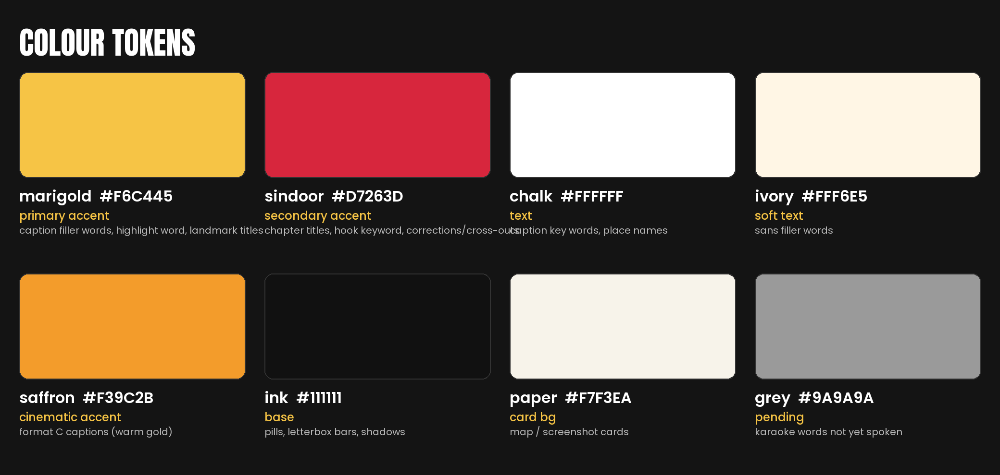
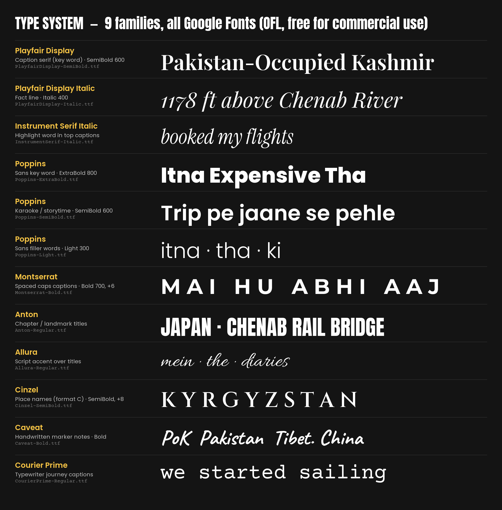
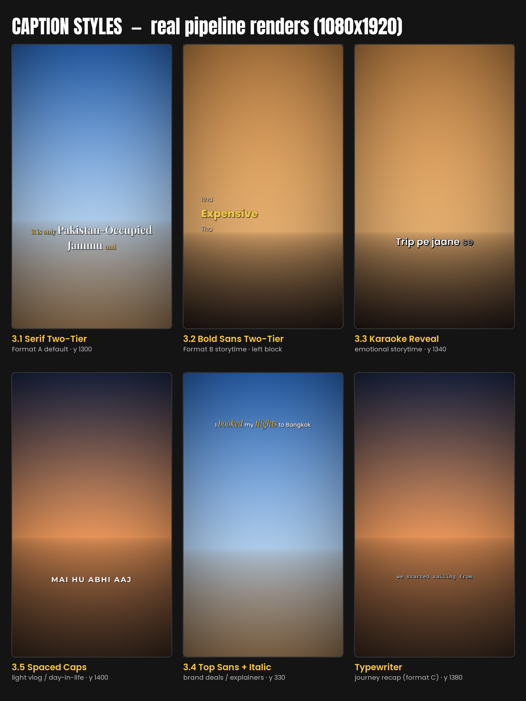
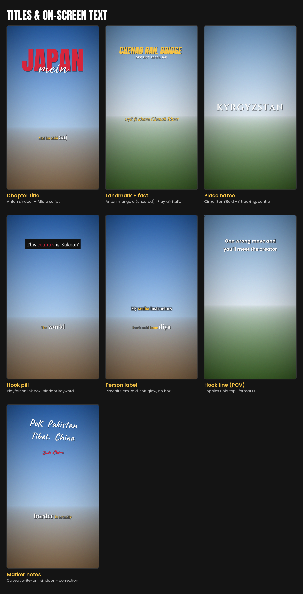
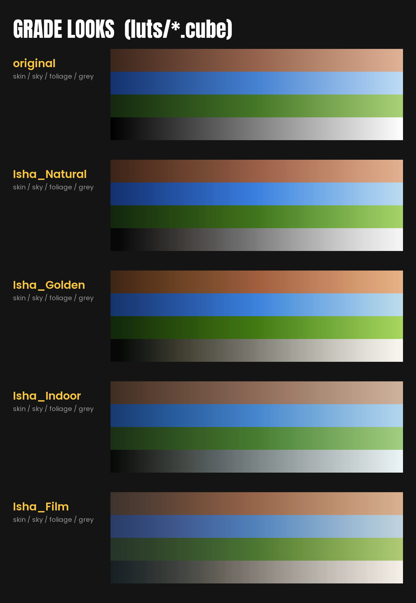

# ISHA — Reel Design System & Editing Brain

> **The single source of truth for every Isha reel.** Whoever edits (Claude with `pipeline/isha.py`, or a human in
> CapCut / Premiere / Resolve) follows this file, so every reel looks like it came from the same channel and sits next to
> the reference creators. The evidence behind every rule (what the references do, with measured numbers) is in
> [`REFERENCE_LIBRARY.md`](REFERENCE_LIBRARY.md).

Reference pool: 8 client-picked reels plus 6 top performers (6.6M–21M views) from the same creators:
`iffy.explorer` · `brindasharma` · `sayannath` · `sailing_amrutha` · `ronnie_and_barty` · `bary__anastasiia`.
What they share: **Indian travel & lifestyle storytelling, creator on camera, Hinglish voice, a natural phone-shot look, and captions that do half the storytelling.**

### Brand kit at a glance
| Asset | Where | Use |
|---|---|---|
| 9 font families (29 static files) + licences | [`fonts/`](fonts/) | install by double-click for CapCut/Premiere; the pipeline loads them automatically |
| Grade looks as LUTs | [`luts/`](luts/) `Isha_Natural/Golden/Indoor/Film.cube` (33-pt) + `_64.cube` | CapCut "Adjust → LUT", Premiere Lumetri "Creative → Look", Resolve |
| Safe-zone overlay | [`brand/safe_zone_overlay_1080x1920.png`](brand/safe_zone_overlay_1080x1920.png) | top layer while editing, delete before export |
| Visual boards | [`brand/`](brand/) 01–05 | what every font, caption, title, colour and grade looks like |
| Edit templates | [`templates/`](templates/) A–D | starting `edit.json` per format |
| Pipeline | [`pipeline/`](pipeline/) | cut, grade, caption, mix, QA, export |

---

## 0. The 10 non-negotiables (Isha DNA)

1. **Story first, Isha in frame.** Every reel is Isha *telling* something: a fact, a feeling, a "what happened". She's on camera or on voiceover in at least 60% of the runtime (cinematic format is the only exception).
2. **Hook in under 1.5 s.** A bold line on screen *and* a strong first visual before the first cut. No logo intros or fades from black.
3. **Hard cuts only** by default. Jump cut on every sentence. **At most one** special transition per reel (whip, flash or match cut).
4. **Pace:** average shot 1.2–2.5 s, first cut within 2.5 s, and faster cutting in the last third.
5. **Captions always on**, 1–4 words per page, word-timed, two-tier hierarchy (§3).
6. **Natural, true-to-life grade.** A great phone shot, not a filter: warm skin, blue skies, dark-but-not-crushed blacks, protected highlights (§4).
7. **One chapter/location title** per reel in big display type (*JAPAN mein*, *KYRGYZSTAN*, *CHENAB RAIL BRIDGE*).
8. **Voice is king.** Music 16–20 dB under the voice with automatic ducking. Final loudness is −14 LUFS.
9. **Safe zones:** no text below y = 1536 (bottom 20%), right of x = 950, or above y = 150 on a 1080×1920 frame.
10. **End on a payoff line**, not "follow for more". The last 1–2 s should make people replay or comment.

---

## 1. Choose the format (one per reel)

| Format | Use when the clips are… | References | Length | Avg shot | Template |
|---|---|---|---|---|---|
| **A. STORY WALK** (default) | selfie/0.5x talking clips at locations + B-roll | iffy border reel, brinda Japan, sayannath manifestation, iffy Chenab (10.3M) | 35–75 s | 1.5–2.5 s | `templates/A_story_walk.edit.json` |
| **B. SIT-DOWN STORYTIME** | Isha at home/desk telling a story + travel B-roll | brinda orca Pt 2, brinda IndiGo, brinda "song" (7.4M) | 40–60 s | 1.1–2 s | `templates/B_storytime.edit.json` |
| **C. CINEMATIC / MOOD** | beautiful B-roll, little or no talking, one song carries it | bary letterbox lyric, sayannath Kyrgyzstan (10.3M), ronnie single shot, sailing anniversary (21M) | 12–35 s | 0.8–1.5 s (beat-cut) | `templates/C_cinematic.edit.json` |
| **D. POV / THRILL** | one adrenaline/wow moment (height, water, wildlife) | sayannath cliff walk (11.9M) | 10–25 s | long takes | `templates/D_pov.edit.json` |

If unsure, use **A**. No usable dialogue → **C**. Brand deal → **A** or **B** with the **Top Sans + Italic** captions (§3.4).

### A. STORY WALK
```
0.0–1.5s  HOOK: strongest line + face close (0.5x / wide selfie); marker notes or hook text appear
1.5–4s    CONTEXT: where are we -> CHAPTER TITLE (place name)
4s–80%    BODY: one idea per sentence, jump cut per sentence; location/outfit changes are fine.
          Every 3–5 talking shots -> 1–2 B-roll overlays while Isha keeps talking (pipeline "broll").
          Facts, names, lists -> handwritten marker notes; corrections -> sindoor cross-out.
last 20%  PAYOFF: emotional or surprising line, faster cuts, face back in frame
```
Captions: **Serif Two-Tier** (§3.1).

### B. SIT-DOWN STORYTIME
```
0–2s      COLD OPEN: 1–2 s of the most dramatic footage LETTERBOXED on black + "What happened?" caption
2–6s      Isha at desk/mic: "So..." -> setup. Warm practical light (grade: indoor)
body      Desk <-> B-roll (>= 40% B-roll). Name a place -> globe/route map on a paper card.
          Optional "green-screen": Isha cut out over a B-roll photo for 2–4 s (do in CapCut: Remove BG).
end       back to desk, reflective line, smile
```
Captions: **Bold Sans Two-Tier** (§3.2) or **Karaoke Reveal** (§3.3).

### C. CINEMATIC / MOOD
```
0–1s      strongest wide or a concept shot (doorway in a field, rotated frame, silhouette) + hook pill on top
body      beat-cut B-roll (every beat or every 2nd beat), PLACE NAME in roman caps over drone shots,
          kinetic lyric type or sparse serif lines
end       hold the last wide shot 1.5–2 s and let the music resolve
```
Variants: **letterbox 2:1** on black (bary), **one unbroken sideways take** (ronnie), **typewriter captions + route map** (sailing 21M).

### D. POV / THRILL
One continuous POV take, 0–3 cuts. **Hook line** on top with an emoji in the post caption ("One wrong move and you'll meet the creator"). Trending Bollywood sound. No word captions; the visual is the story.

---

## 2. Brand tokens



### 2.1 Colour
| Token | Hex | ASS (&HBBGGRR) | Use |
|---|---|---|---|
| `ink` | `#111111` | `&H111111&` | pills, letterbox bars, shadows |
| `chalk` | `#FFFFFF` | `&HFFFFFF&` | key caption words, titles |
| `ivory` | `#FFF6E5` | `&HE5F6FF&` | sans filler words |
| **`marigold`** (primary accent) | `#F6C445` | `&H45C4F6&` | serif filler words, highlight words, landmark titles |
| **`sindoor`** (secondary accent) | `#D7263D` | `&H3D26D7&` | chapter titles, hook keyword, corrections/cross-outs |
| `saffron` | `#F39C2B` | `&H2B9CF3&` | cinematic-format captions (warm gold, sayannath style) |
| `paper` | `#F7F3EA` | `&HEAF3F7&` | map/screenshot card background |
| `grey` | `#9A9A9A` | `&H9A9A9A&` | karaoke words not yet spoken |

**Rules:** one accent per caption page. If Isha's outfit has a strong colour, match the chapter-title colour to it (brindasharma's red titles match her red sweater; pass `"color"` on the title). Otherwise sindoor for titles, marigold for captions.

### 2.2 Type system



Nine families, all **Google Fonts under the SIL Open Font License** (free for commercial use; licences in `fonts/licenses/`). **Per reel: one caption family + one title lockup (Anton + Allura count as one) + at most one accent family (Caveat / Instrument Serif / Courier Prime).** With `top` captions, top titles automatically move down 300 px; title colours accept a token name or `#RRGGBB`.

| Role | Family · weight | File in `fonts/` | Seen in |
|---|---|---|---|
| Caption serif, key word | **Playfair Display** SemiBold 600 | `PlayfairDisplay-SemiBold.ttf` | iffy.explorer, sayannath |
| Caption serif, filler words | Playfair Display SemiBold 600 (smaller, marigold) | same | iffy.explorer |
| Fact line / pill | Playfair Display Italic 400 / Regular | `PlayfairDisplay-Italic.ttf`, `-Regular.ttf` | iffy Chenab, sayannath |
| Highlight word (top captions) | **Instrument Serif** Italic | `InstrumentSerif-Italic.ttf` | brinda IndiGo |
| Sans key word | **Poppins** ExtraBold 800 | `Poppins-ExtraBold.ttf` | brinda orca |
| Sans body / karaoke | Poppins SemiBold 600 / Medium 500 | `Poppins-SemiBold.ttf`, `-Medium.ttf` | brinda 7.4M |
| Sans filler words | Poppins Light 300 | `Poppins-Light.ttf` | brinda orca |
| Spaced caps captions | **Montserrat** Bold 700, tracking +6 | `Montserrat-Bold.ttf` | brinda Japan |
| Chapter / landmark titles | **Anton** Regular | `Anton-Regular.ttf` | brinda "JAPAN", iffy "CHENAB RAIL BRIDGE" |
| Script accent over titles | **Allura** Regular | `Allura-Regular.ttf` | brinda "Mein", "the" |
| Place names (format C) | **Cinzel** SemiBold 600, tracking +8 | `Cinzel-SemiBold.ttf` | sayannath "KYRGYZSTAN" |
| Handwritten marker notes | **Caveat** Bold 700 | `Caveat-Bold.ttf` | iffy.explorer annotations |
| Typewriter journey captions | **Courier Prime** Regular | `CourierPrime-Regular.ttf` | sailing_amrutha 21M |

**Sizing is calibrated to the references**, not guessed. Each size makes a sample phrase occupy the same share of the 1080 px frame width as in the reference reel (`pipeline/calibrate_type.py`). Human editors: type the sample phrase and scale it until it spans that width, then keep that size for the whole reel.

| Element | Pipeline size (libass) | Sample phrase → width share | Reference |
|---|---|---|---|
| Serif key word | 103 (filler 60) | "Pakistan-Occupied" → **59%** | iffy R1 |
| Sans key word | 128 (filler 73) | "Expensive" → **35%** | brinda orca |
| Karaoke line | 115 | "Trip pe Jaane se" → **50%** | brinda 7.4M |
| Spaced caps | 77 (+6 tracking) | "MAI HU ABHI AAJ" → **49%** | brinda Japan |
| Top sans (accent 86) | 68 | "I booked my flights" → **34%** | brinda IndiGo |
| Typewriter | 49 | "we started sailing from" → **47%** | sailing 21M |
| Chapter title | 524 (auto-fit) | "JAPAN" → **66%** | brinda Japan |
| Script accent | 383 (scales with title) | "mein" → **33%** | brinda Japan |
| Landmark title | 169 (auto-fit) | "CHENAB RAIL BRIDGE" → **68%** | iffy V3 |
| Place name | 136 (auto-fit) | "KYRGYZSTAN" → **72%** | sayannath V1 |
| Hook pill (incl. box) | 81 | "This country is 'Sukoon'" → **61%** | sayannath V1 |
| Hook line | 96 | "One wrong move and you'll" → **70%** | sayannath V2 |
| Fact line | 78 | "1178 ft above Chenab River" → **59%** | iffy V3 |
| Marker note | 149 | "PoK Pakistan" → **49%** | iffy R1 |

Long titles auto-shrink so they never exceed the 78% safe width on one line.

---

## 3. Caption & on-screen text styles



**Shared rules:** 1–4 words per page (serif allows 5 when short), at most 2 lines, centred inside x 110–950. Pages switch on real word timestamps (never split evenly). No page ends on a dangling *the/of/ka/ki*, and no filler word sits alone. **Entrance:** pop from 92% → 100% scale over 90 ms with a 40 ms fade. No exit animation; the next page replaces it. **Shadow:** 45% black, 4 px offset; outline 1.5 px at 37% black.

| # | Style (`--style`) | Spec | Position (y of 1920) | Use |
|---|---|---|---|---|
| 3.1 | **Serif Two-Tier** `serif` | Playfair SemiBold. Key word(s) **white, big**; connecting words **marigold, 58% size**, inline in reading order | centre **1300** (68%) | **Format A default** |
| 3.2 | **Bold Sans Two-Tier** `sans` | stacked left block: filler Poppins Light ivory, key word Poppins ExtraBold **marigold** | left x 120, y **1150** | Format B storytime |
| 3.3 | **Karaoke Reveal** `karaoke` | Poppins SemiBold; whole page visible, words grey at 80% → white as spoken | centre **1340** (70%) | emotional storytime |
| 3.4 | **Top Sans + Italic** `top` | Poppins Medium white + Instrument Serif Italic **marigold** highlight words (1–2 per page) | top **300** (16%) | brand deals, explainers (frees the lower frame) |
| 3.5 | **Spaced Caps** `caps` | Montserrat Bold ALL CAPS, +6 tracking, white | centre **1400** (73%) | light vlog / day-in-life |
| 3.6 | **Typewriter** `typewriter` | Courier Prime lowercase, words appear one by one | centre **1380** | format C journey recap |

**Key-word picking:** the longest non-filler word on each page gets the big/accent treatment (two on 4+ word pages). Hinglish fillers (*hai, toh, ka, ki, mein, bhi, na…*) never do. Override with `"emph": true` in `words.json`.

### Titles & graphics



| Title (`type`) | Spec | Position | When |
|---|---|---|---|
| **Chapter** `chapter` | Anton caps **sindoor** (or outfit colour) + Allura script word in white overlapping the lower third of the title ("JAPAN" + "mein") | y **370** | first time a place appears (A/B) |
| **Landmark** `landmark` | Anton caps **marigold**, italic-sheared + Montserrat Bold white subtitle | y **280** | big landmark facts (iffy Chenab) |
| **Place name** `place` | Cinzel SemiBold, +8 tracking, white, fades 250 ms, hold 1.5–2.5 s over drone shots | centre **960** | format C |
| **Hook pill** `pill` | Playfair white on an **ink** box, `*keyword*` in sindoor; persists through the hook (or the whole reel, sayannath style) | top **300** | concept hooks (C/D, any) |
| **Person label** `label` | Playfair SemiBold white on a soft dark glow (no box), `*keyword*` in marigold, size 70 | y **1090** (above the caption band) | who's on screen in a montage ("My *scuba* instructors"); use instead of `pill` when a box feels too heavy |
| **Hook line** `hook` | Poppins Bold white, outline, wraps to 2 lines | top **260** | format D |
| **Fact line** `fact` | Playfair Italic **marigold** | y **1090** (just above the caption band) | stats, heights, prices |
| **Marker note** `marker` | Caveat Bold, white = note, **sindoor + strike** = correction; ±3° rotation; writes on left→right in 450 ms | sky / top third, y 150–600 | facts, lists, corrections (max 4 per reel) |
| **Kinetic lyric** (manual) | mixed Playfair upright/italic 60–140 px words scattered and stacked, each popping on its syllable; final word in giant Anton sindoor + 2 shrinking outline echoes ("FREE") | full frame | format C, max once. Build in CapCut/After Effects |

### Recreating the styles by hand (CapCut / Premiere / Resolve)
1. Install every `.ttf` in `fonts/` (double-click → Install) and restart the editor.
2. Drop `brand/safe_zone_overlay_1080x1920.png` as the top track at 100% (delete it before export).
3. **Captions:** CapCut *Auto captions* → pick the font/weight from §2.2 → set size by the width-share trick (type the sample phrase, scale until it spans the listed %) → y position from the tables above → shadow black 45%, distance ~4, blur ~2 → animation *In: Pop / Zoom in*, 0.1 s. For two-tier, select filler words and set them to 58% size + marigold `#F6C445`.
4. **Titles:** text from the titles table, same width-share method; chapter script word as a second text layer overlapping the bottom third of the title.
5. **Grade:** CapCut *Adjust → LUT → Import* `luts/Isha_*.cube` (33-pt), intensity 100%; Premiere *Lumetri → Creative → Look → Browse*.
6. Export 1080×1920, 30 fps, high bitrate, HDR **off**.

---

## 4. Colour grade



**Look name: "Isha Natural".** Measured target from the reference reels (8-bit, full frame):

| Metric | Target | Reference range |
|---|---|---|
| Mean luma | 100–120 | 98–126 |
| 5th-percentile luma (blacks) | 18–24 | 15–23 (43 in the filmic sayannath look) |
| 95th-percentile luma (highlights) | 195–215 | 187–216 |
| Saturation (HSV mean) | 0.30–0.35 | 0.30 typical, 0.50 on vivid blue-sky days |
| White balance | skin warm, sky blue: R > B on faces, B > R on sky shots | — |

| Look | LUT file | Use | What it does |
|---|---|---|---|
| `natural` (default) | `Isha_Natural.cube` | daylight outdoor | +4% contrast, soft highlight roll-off, black floor lifted to ~8/255, +12 vibrance, tiny warm push in mids |
| `golden` | `Isha_Golden.cube` | sunset / golden hour | natural + warmer mids/highlights, +6% saturation |
| `indoor` | `Isha_Indoor.cube` | desk/home storytime under tungsten | tames orange (−5% red in highlights), keeps skin warm, brighter mids |
| `film` | `Isha_Film.cube` (+ add ~5% grain) | format C cinematic | lifted blacks (p5 ~40), teal shadows, warm highlights, −8% saturation |

**Order:** correct first (exposure, white balance, match shots to each other), then the look. Skin never goes orange or grey. Shot-to-shot brightness stays within about ±8 luma. iPhone HDR footage is tone-mapped to SDR first (the pipeline does it automatically; in CapCut turn HDR off on export).

---

## 5. Motion, transitions & framing
- **Jump cut** on sentence boundaries. Remove "umm" and breaths, leaving 2–4 frames of air.
- **Punch-in** 108–115% on every 2nd or 3rd consecutive talking cut from the same setup, to hide the jump.
- **B-roll overlay (L-cut):** 0.8–2 s of B-roll on top of a talking clip while her voice continues (pipeline: `"broll": [{"src", "in", "at", "dur"}]`).
- **Special transition** (max 1 per reel): `whip` (on a camera pan), `flash` (2-frame white on a beat drop), `match` (same shape/motion across the cut).
- **Speed ramp:** at most once (1.0 → 2.0 → 1.0 on a walking shot).
- **Letterbox band** (`frame: letterbox` / `letterbox_wide`): horizontal footage full-width on black. For the cold open (B) and cinematic mood (C).
- **Rotated frame** (`rotate: 90`): a deliberately sideways landscape shot (went viral twice in the references). Single scenic take or BTS gag only.
- **Map:** globe → country → pin, or a route line with a moving icon. Export 9:16 from Google Earth Studio or a route-map app, then `frame: card` (rounded card on paper).
- **Framing:** eyes on the upper third; 0.5x wide selfies are on-brand; keep the face clear of the caption band.



---

## 6. Audio & music
| Layer | Spec |
|---|---|
| Voice | high-pass 80 Hz, light denoise, 3:1 compression; peaks −3 dBFS |
| Music bed | −16 to −20 dB under the voice, sidechain duck (20 ms attack, 250 ms release); +6 dB in voice-less B-roll and the ending; 0.6 s fade out |
| Loudness | integrated **−14 LUFS**, true peak **≤ −1.5 dBTP** |
| SFX | optional: whoosh on the special transition, soft pop on the chapter title. Never on every cut |

**Music moods** (pick by format; these are the reference tracks, use as a direction, not necessarily the same song):
| Mood | Format | Reference tracks |
|---|---|---|
| Epic / cinematic score | A explainer | M. M. Keeravaani *The King and His Sword*; Hans Zimmer *Mountains* |
| Warm indie / acoustic | A, C mood | Lizzy McAlpine *To the Mountains*; Richy Mitch & the Coal Miners *Evergreen*; Jorja Smith *The One* |
| Nostalgic Bollywood | B emotional, A | *Dil Haara* (Tashan); *Dil Dhadakne Do*; *Yeh Duniya* |
| Classic rock / lyric | C kinetic lyric | The Beatles *Come Together* |
| Trending Bollywood remix | D POV | *Hum Pyaar Karne Wale* (Dhurandhar remix) |

**Licensing:** if we don't own a track, export without music (or voice-only) and add the sound inside Instagram when posting.

---

## 7. Hooks library (first 1.5 s)
| Type | Example (Isha voice) | Ref |
|---|---|---|
| Myth-buster | "PoK, Pakistan, Tibet, China… the map they taught us is wrong." + marker notes | iffy |
| Question | "What happened?" over letterboxed action | brinda orca |
| Status flex | "*Japan mein* main hu abhi aaj…" + chapter title | brinda Japan |
| Concept visual | walking through a door standing in an empty field | sayannath Kyrgyz |
| Danger POV | "One wrong move and you'll meet the creator" | sayannath cliff |
| Superlative fact | "Taller than the Eiffel Tower. In India." | iffy Chenab |
| Emotional confession | "There's this one song I keep on repeat on every trip…" | brinda 7.4M |
| Persistent promise | "This video will find you when the time is right" (pill stays all reel) | sayannath manifestation |
| BTS reveal | photographer shooting her, then the final photo pops in picture-in-picture | brinda 6.6M |

---

## 8. Shooting guide for Isha (so the edit can look like the references)
Shoot vertical 4K or 1080p at **30 fps** (or 60 fps for slow-mo B-roll). Turn HDR video off if possible. Lock exposure on her face. Use a clip-on mic or AirPods for talking shots.

**Every location, film this checklist:**
| Shot | How | Used for |
|---|---|---|
| 0.5x selfie talking, 2–3 takes of each line | arm extended, low angle, sky behind | A-roll (all formats) |
| Walk-to-camera / walk-and-talk | phone on a stick or a friend filming, 10–15 s | hooks, A-roll |
| Wide establishing shot | 5 s still, then 5 s slow pan | chapter title background |
| Hand-reveal | her hand in the foreground pointing or waving at the view | B-roll, transitions |
| POV | phone at chest/eye height walking, cycling, on a boat | B-roll, format D |
| Details | food, tickets, signs, textures, 3 s each | B-roll |
| Drone or high vantage (if possible) | slow push or rise, 8–10 s | place-name titles (C) |
| One "concept" shot | something visual to open with: doorway, rotated frame, silhouette, jump | hooks |
| Room tone | 5 s of silence at each spot | audio clean-up |
| For storytime (B) | desk, warm lamp, plants behind, mic in frame, eye line just above the lens | B |

**Talking tips:** say the hook line 3 ways. Keep each sentence short (one idea). Pause 1 s between sentences (clean cut points). Speak in natural Hinglish.

---

## 9. Hinglish caption rules (proofreading `words.json`)
- Roman script only, never Devanagari. Write words the way they're said, e.g. *Mai hu abhi aaj*, *Itna expensive tha*, *Trip pe jaane se pehle*.
- House spellings: **mai** (I), **hu** (am), **hai**, **nahi**, **bahut**, **kya**, **kyunki**, **matlab**, **yaar**, **accha**, **sab**, **wahi**, **mein** (in).
- Proper nouns stay correct and capitalised: *Kyrgyzstan, Ladakh, Chenab, IndiGo*.
- Numbers as digits (*5 days*, *₹19,000*, *1178 ft*).
- Captions follow the exact spoken words, minus "umm"/false starts. **Never invent or "improve" what she said.**
- English words inside Hinglish stay in English spelling (*trip, flight, expensive*).

---

## 10. Covers / thumbnails
- Pick a frame with Isha's face plus the place. Put the **chapter or landmark title** on it in the same style as the reel (the pipeline exports `<name>_cover.png` at the title frame).
- Title inside the centre 4:5 area (y 240–1680), since the profile grid crops to 4:5.
- Same type system as the reel, so the grid looks like one channel (iffy and brinda grids are recognisable at thumbnail size).

---

## 11. Export spec
- 1080×1920, 9:16, **30 fps** constant (VFR phone footage conformed).
- H.264 High, CRF 18 (~12–16 Mbps), yuv420p, BT.709 tagged. AAC 320 kbps, 48 kHz.
- Deliver: `<name>.mp4`, `<name>_clean.mp4` (no text, for re-use), `<name>.srt`, `<name>_cover.png`.

---

## 12. Do / Don't
| Do | Don't |
|---|---|
| Hard cut on the sentence | crossfade between talking shots |
| One accent colour per page | rainbow captions, a different colour per word |
| Text in the safe bands | text over her mouth or in the bottom 20% |
| One special transition, motivated | glitch / spin / zoom transitions on every cut |
| Natural grade, warm skin | teal-orange filter on everything, crushed blacks |
| Music under the voice | music fighting the voice, or no ducking |
| One chapter title, big | three different title styles in one reel |
| Real words from the transcript | invented captions, misspelled place names |
| Emoji in the post caption | emoji in burned-in text (they render monochrome) |

---

## 13. Edit workflow (what Claude does when clips arrive)
1. **Ingest:** clips → `inbox/<reel>/`. Run `python pipeline/isha.py probe inbox/<reel>/*` and `sheet` each clip; look at the sheets.
2. **Brief:** confirm the topic, one-line takeaway, format (A–D) and must-have moments with the user.
3. **Cut list:** copy the format template to `projects/<reel>/edit.json`; fill in clips, B-roll overlays, titles, music.
4. **Assemble:** `render --stage assemble` → review `build/assembled_sheet.png` and fix.
5. **Transcribe:** `transcribe projects/<reel>/build/assembled.mov --out projects/<reel>/words.json` → proofread (§9).
6. **Finish:** `render --stage finish` → captions, titles, grade, mix, loudness, QA → check stills at the hook, middle and end.
7. **Deliver** the `out/` paths and ask the user to watch at real speed on a phone before posting.

## 14. QA checklist (must pass before delivery)
- [ ] Hook text and a strong visual at 0.0 s; first cut ≤ 2.5 s
- [ ] Average shot length within the format target
- [ ] Every caption matches the spoken words (proofread), ≤ 4 words per page, inside the safe zone
- [ ] Exactly one chapter/place title, spelled correctly
- [ ] Grade: no orange skin, no clipped sky, shots matched
- [ ] −14 LUFS ±1, true peak ≤ −1.5 dBTP, voice always intelligible over music
- [ ] 1080×1920, 30 fps CFR, BT.709, plays in a phone preview
- [ ] Clean version + SRT + cover exported
